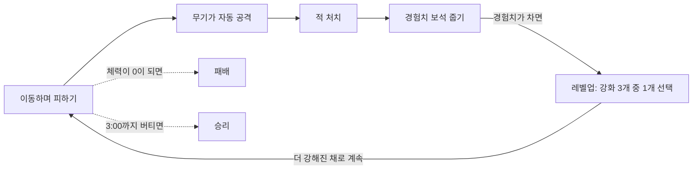

# 뱀서라이크 미니 게임 PRD

2026-10-23 기준 · 원본 문서: https://claude.ai/artifact/VqAmcZ65GauR7s2WibSgHU

## 0. AI에게 보내는 요청 (그대로 두세요)

당신은 이 프로젝트를 함께 만드는 개발 담당자입니다. 아래 요구 사항 문서를 읽고,

1. 이해한 내용을 3~5줄로 요약해서 확인받으세요.
2. 문서에서 불명확하거나 결정이 필요한 부분이 있다면, 작업 시작 전에 저에게 질문하세요.
3. 확인이 끝나면 구현 계획(단계별 할 일 목록)을 먼저 제안하고, 제가 승인하면 작업을 시작하세요.
4. "만들지 않는 것" 항목에 있는 기능은 제가 따로 요청하기 전까지 절대 만들지 마세요.

## 1. 프로젝트 개요

이동만 하면 무기가 알아서 공격하는 탑다운 생존 게임입니다. 사방에서 몰려오는 적을 3분 동안 버티면 승리합니다.

- **장르**: 뱀서라이크(Vampire Survivors류), 탑다운 2D, 싱글 플레이
- **한 판 길이**: 3분 + 결과 화면
- **플랫폼**: PC 데스크톱(macOS·Windows) 우선
- **엔진**: Godot 4.7, 기존 `vampsulike` 프로젝트에서 작업
- **핵심 재미**: 점점 늘어나는 적 사이를 빠져나가며, 레벨업 때마다 고른 강화로 화면을 쓸어버리는 느낌

## 2. 목표와 성공 기준

승리 조건은 하나뿐입니다. 타이머가 3:00에 도달할 때까지 체력이 0이 되지 않으면 승리, 그 전에 0이 되면 패배입니다.

완성 판단 기준:

- [ ] 처음 하는 사람이 설명 없이 10초 안에 조작을 이해한다.
- [ ] 게임 실행 후 클릭이나 키 입력 1번으로 플레이가 시작된다.
- [ ] 한 판이 최대 3분 뒤 결과 화면으로 끝나고, 바로 다시 할 수 있다.
- [ ] 적 150마리가 동시에 있어도 60 FPS를 유지한다.
- [ ] 난이도는 어렵게 잡는다. 처음 하는 사람은 첫 판에 거의 클리어하지 못하고, 강화 조합을 익혀야 3분을 버틸 수 있다.

## 3. 핵심 게임 루프와 조작

플레이어는 움직이기만 하고, 공격과 강화가 그 움직임을 더 안전하게 만들어 주는 루프입니다.

시간이 지날수록 적이 더 많이 나오므로, 레벨업으로 강해지는 속도가 적이 늘어나는 속도를 따라가야 버틸 수 있습니다.

| 상황 | 입력 |
| --- | --- |
| 전투 중 이동 | WASD 또는 방향키, 8방향 |
| 레벨업 강화 선택 | 마우스 클릭 (게임이 멈춘 상태, 키보드 선택 없음) |
| 결과 화면에서 다시 하기 | Space 또는 Enter |

## 4. 기능 요구사항

P0만 있어도 3분 한 판을 끝까지 할 수 있어야 합니다. P1은 재미와 다양성, P2는 여유가 있을 때 하는 마무리입니다. 순서는 P0 전부 → P1 → P2입니다.

### P0: 플레이 가능한 최소판

| ID | 기능 | 완료 기준 |
| --- | --- | --- |
| P0-1 | 플레이어 이동 | WASD·방향키로 8방향 이동, 대각선도 같은 속도, 카메라가 플레이어를 따라감 |
| P0-2 | 자동 공격 | 기본 무기 1종: 가장 가까운 적에게 일정 간격으로 투사체 발사, 공격 버튼 없음 |
| P0-3 | 적 스폰과 추적 | 화면 밖 사방에서 나타나 플레이어를 향해 이동, 시간이 지날수록 스폰량 증가 |
| P0-4 | 체력과 피격 | 적과 닿으면 데미지, 피격 후 잠깐 무적, 체력 0이면 패배 |
| P0-5 | 3분 타이머와 승리 | 3:00 카운트, 도달하면 즉시 승리 처리 |
| P0-6 | 경험치와 레벨업 | 적 처치 시 경험치 보석 드롭, 가까이 가면 흡수, 레벨업 시 게임이 멈추고 강화 3개 중 1개 선택 |
| P0-7 | HUD | 체력바, 남은 시간, 레벨과 경험치바, 처치 수 표시 |
| P0-8 | 결과 화면과 재시작 | 승리/패배, 생존 시간, 처치 수, 도달 레벨 표시, 키 하나로 다시 시작 |

### P1: 재미와 다양성

| ID | 기능 | 완료 기준 |
| --- | --- | --- |
| P1-1 | 무기 추가 | 플레이어 주위를 도는 구슬, 주변 범위 데미지 오라, 관통 투사체 중 2~3종 |
| P1-2 | 무기 레벨업 | 같은 무기를 다시 고르면 강해짐, 최대 5레벨 |
| P1-3 | 패시브 강화 | 이동 속도, 최대 체력, 보석 흡수 범위, 공격 속도 |
| P1-4 | 적 종류 추가 | 기본형 외에 빠르고 약한 적, 느리고 튼튼한 적 |
| P1-5 | 마지막 엘리트 적 | 종료 직전에 강한 적이 한 번 등장해 마지막 긴장감을 줌 |
| P1-6 | 타격 피드백 | 피격 깜빡임, 데미지 숫자, 가벼운 화면 흔들림 |
| P1-7 | 사운드 | 공격·처치·피격·레벨업 효과음, 배경 음악 1곡 |
| P1-8 | 일시정지 | Esc로 멈추고 재개·다시하기·종료 선택 |

### P2: 여유가 있을 때

| ID | 기능 | 완료 기준 |
| --- | --- | --- |
| P2-1 | 회복 아이템 | 낮은 확률로 드롭되는 체력 회복 |
| P2-2 | 최고 기록 저장 | 최장 생존 시간과 최다 처치 수를 로컬에 저장해 결과 화면에 표시 |
| P2-3 | 타이틀 화면 | 게임 이름, 시작, 조작 안내 |
| P2-4 | 게임패드 | 왼쪽 스틱으로 이동, 버튼으로 레벨업 선택 |
| P2-5 | 설정 | 효과음·음악 볼륨 |
| P2-6 | 웹 빌드 | 브라우저에서 바로 플레이할 수 있는 HTML5 내보내기 |

## 5. 만들지 않는 것

아래 기능은 따로 요청하기 전까지 만들지 않습니다. 만들어야 할 것 같아 보여도 먼저 물어봐 주세요.

- **멀티플레이**: 온라인, 로컬 협동, 랭킹 서버 모두 제외
- **스토리**: 대사, 컷신, 캐릭터 설정, 캠페인 모드 모두 제외
- **점프**: 점프와 높이(Z축) 개념 없음. 움직임은 평면 이동뿐
- **수동 공격**: 조준, 공격 버튼, 스킬 버튼 없음. 전투 중 입력은 이동뿐

## 6. 기술 환경

기존 Godot 프로젝트 `vampsulike`에 GDScript로 만듭니다. 새 프로젝트를 만들지 않습니다.

| 항목 | 내용 |
| --- | --- |
| 엔진 | Godot 4.7.1, 렌더러 GL Compatibility |
| 언어 | GDScript, 타입 명시 |
| 프로젝트 경로 | `/Users/wade/Projects/vampsulike` |
| 현재 상태 | 벽돌 깨기 데모(`breakout.gd`, `breakout.tscn`)가 들어 있음. 작업을 시작할 때 삭제 |
| 화면 | 1280×720(16:9) |
| 맵 | 끝없이 이어지는 평원, 경계 없음 |
| 그래픽 | 처음에는 도형(원·사각형)으로 만들고, 아트 에셋은 나중에 교체 |
| 화면 글자 | 한글. 기본 폰트에 한글이 없으므로 한글 폰트 파일을 프로젝트에 추가 |
| 테스트 | `--headless`로 실행해 스크립트 오류가 없는지 확인 |

## 7. 초기 밸런스 값

아래 값은 시작점일 뿐이고, 플레이해 보면서 조정합니다. 코드에서는 한곳에 상수로 모아 두어 쉽게 바꿀 수 있게 합니다.

| 항목 | 초기값 |
| --- | --- |
| 플레이어 최대 체력 | 100 |
| 플레이어 이동 속도 | 200 px/초 |
| 피격 후 무적 시간 | 0.5초 |
| 기본 무기 발사 간격 | 1.0초 |
| 기본 무기 데미지 | 10 |
| 투사체 속도 | 400 px/초 |
| 기본 적 체력 | 10 (기본 무기 1발) |
| 기본 적 이동 속도 | 80 px/초 |
| 적 접촉 데미지 | 10 |
| 스폰 속도 | 0:00에 초당 1마리 → 3:00에 초당 6마리, 일정하게 증가 |
| 동시 적 상한 | 150마리 |
| 적 1마리 경험치 | 1 |
| 레벨업 필요 경험치 | 5 + 현재 레벨 × 5 |
| 보석 흡수 범위 | 60 px |

## 8. 결정 사항

열려 있던 질문은 모두 결정됐습니다. 새로 결정이 필요한 부분이 생기면 작업 전에 물어봐 주세요.

| 질문 | 결정 |
| --- | --- |
| 벽돌 깨기 데모 | 삭제 |
| 화면 비율 | 1280×720(16:9) |
| 맵 | 끝없이 이어지는 평원 |
| 레벨업 선택 입력 | 마우스 클릭만, 키보드 선택 없음 |
| 화면 글자 | 한글, 한글 폰트 추가 |
| 목표 난이도 | 어렵게. 첫 판 클리어는 드물게 |
